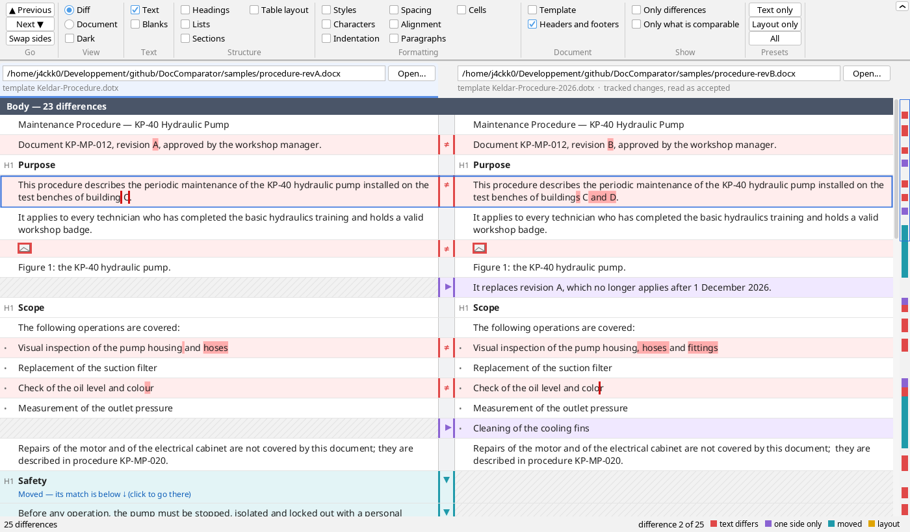
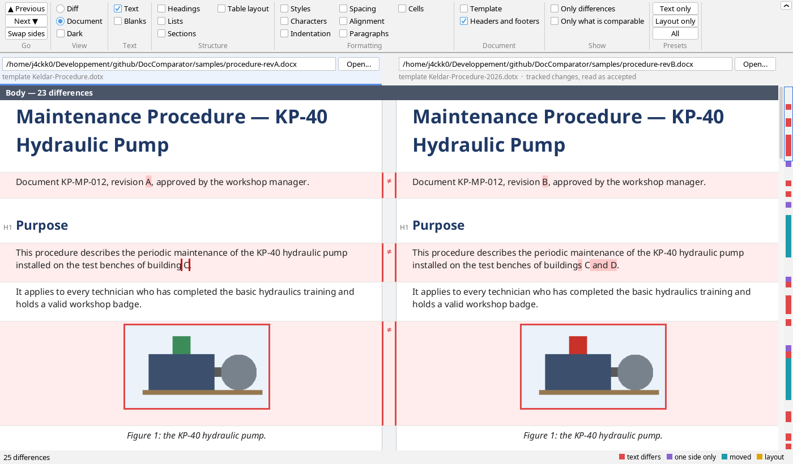
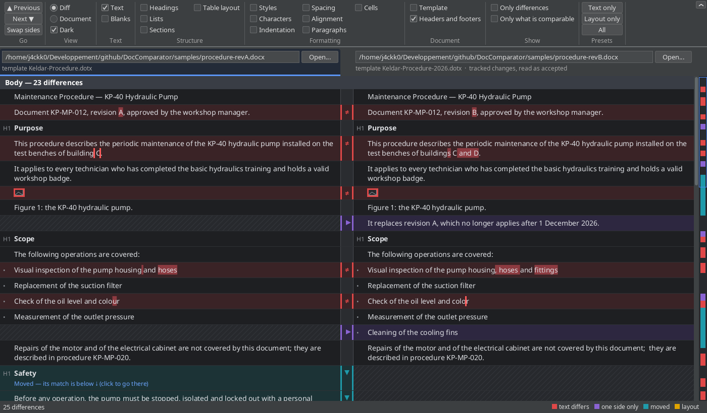
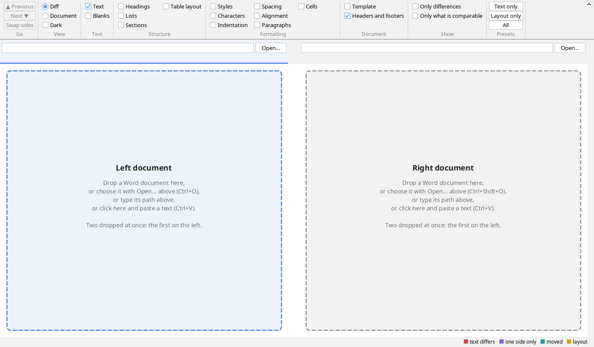

# DocComparator

[](https://github.com/j4ckk0/DocComparator/actions/workflows/build.yml)
[](LICENSE)


**See what changed between two Word documents.** DocComparator puts two `.docx` files side by side, paragraph beside
paragraph, and marks what differs: the words and letters changed, the paragraphs added, removed or moved, the tables
row by row and column by column. It compares the text first. Each kind of layout (headings, lists, styles, indents,
spacing, table layout, cell shading…) has its own switch and is compared only when you ask for it. It compares two
versions of one file. It also compares two different documents, where one took paragraphs from the other and changed
pieces of them. Excel workbooks (`.xlsx`), PDFs and text files (`.txt`, `.md`) compare too: a workbook's sheets as
tables, their values, formulas and formatting; a PDF's text, its paragraphs rebuilt from its lines, and its fonts.

It is a desktop program that runs on its own: each distribution carries its Java runtime, so nothing needs installing
where it is unpacked, and it **never reaches the network**: no update check, no telemetry, no name lookup (see
[No network](#no-network)). It speaks French and English.

[**Download the latest release**](https://github.com/j4ckk0/DocComparator/releases/latest) for Windows or Linux — nothing
to install, a Java runtime is inside: unpack it anywhere and start `doccomparator.bat` (Windows) or `doccomparator.sh`
(Linux).

| | |
|---|---|
| You compare documents | [**Screenshots**](#screenshots), then [**The window**](#the-window): what it shows and how to use it |
| You want it on your machine | [**Build and run**](#build-and-run) and [**Packaging**](#packaging): self-contained archives for Windows and Linux |
| You read or change the code | [**How it compares**](#how-it-compares) and [**Layout**](#layout) |
| Your security team asks | [**No network**](#no-network): what the program does not do, and the checks that keep it so |

## Screenshots

**The diff view**: revision A of the sample procedure on the left, revision B on the right, 23 differences in the
body.
- **Red** marks text that differs, with the words or letters changed shown darker; a `≠` sign sits in the gutter.
- **Purple** marks a paragraph on one side only.
- **Teal** marks a moved paragraph: the *Safety* section, swapped with the next one, says where its match is. Click it
  to go there.
- The redrawn figure is a picture that differs.
- The map at the right shows every difference at its height; a click goes there.



**The document view**: the same comparison, with each paragraph as Word lays it out through its styles. You see
headings in their font and colour, the redrawn figure framed in red, and the caption in italics. The paragraphs stay
paired and their differences stay marked.



**A dark look**: the ribbon's *Dark* box turns the window and the diff view dark. The document view keeps its white
page.



**Before the documents**: each side says how to fill it. You can drop a Word document, an Excel workbook, a PDF or a
text file on it, choose one with *Open…*, type its path, or click the side and paste a text (Ctrl+V). The side
clicked, where the paste goes, shows in blue.



## No network

The program opens a window in its own process, and that is all: no server, no port, not even on `127.0.0.1`; no update
check, no browser, no mail client, no other program started.

**No name lookup either, not even the JDK's own.** On Linux, Swing's fonts look up the machine's name the first time
text is drawn, to name their cache file in `~/.java/fonts/`: a DNS query, which the search domain may carry beyond the
machine. `NoNetworkResolver` takes the place of Java's name service (through
`META-INF/services/java.net.spi.InetAddressResolverProvider`) and answers every lookup as an unknown host, which the JDK
expects: the font cache is then named after `localhost`. It covers every lookup Java would make, whoever makes it.

**A document cannot make it reach the network either.** XML can name a DTD or an entity elsewhere, which a parser
fetches unless told not to: `XmlCursor`, the program's only XML parser, supports no DTD, no external entity, no
protocol to fetch them with, and refuses a part that has a DOCTYPE, which Word never writes. The links a document
holds — the template it is attached to, often on a network share, a linked picture, a hyperlink — are read as text
and never followed: a picture whose relationship points outside the document, whether linked or said to be embedded,
is shown as a frame saying so, never fetched.

**Pictures are decoded as untrusted.** A document's pictures are decoded by the JDK's ImageIO, its size read first: one
saying it has more than 100 million pixels is not decoded, nor one the memory there is cannot hold; the others at most 1000 pixels on their longer side, a line
in so many skipped, whatever they hold; one larger than 32 MiB is not kept; an image used again is read and kept once; those of documents no longer shown
are let go. ImageIO's cache, which it keeps on disk in
the temporary directory unless told not to, is turned off as the program starts: decoding writes nothing.

Two checks run with every build, so a change that breaks the rule does not build:

- **`NoNetworkTest`** reads every compiled class of the program, in its three modules, and fails on any name of what the JDK reaches the network
  with: the packages `java.net`, `javax.net`, `jdk.net`, `sun.net`, `com.sun.net`, `java.rmi`, `javax.rmi`,
  `javax.naming` and `javax.management.remote`; `java.awt.Desktop`, whose `browse()` and `mail()` start other programs
  that do; `ProcessBuilder` and `Runtime.exec`, since another program would do what this one may not; the JDK's XML
  parsers' factories, as above, but in `XmlCursor`. It reads the
  class files, not the sources, so that a fully qualified name, a method reference or a class named for reflection is
  seen as well as an import. A second test checks that it does find each of these. The exemptions are two, each limited
  to what it names: `NoNetworkResolver` names the resolver types it implements, `XmlCursor` makes its parser.
- **The enforcer rule of `pom.xml`** fails the build when a library would ship with the program, but one, by name and
  version: **FlatLaf** (3.7.2, Apache License 2.0), the window's looks, a decision taken knowingly. Its classes are in
  `doccomparator.jar`, and `NoNetworkTest` reads every one of them, at each build, as it reads the program's, with two
  allowances, each the narrowest found to hold: java.net's `URL` and `URI` (FlatLaf reads its themes and fonts from
  its own jar by the addresses `Class.getResource` gives; no socket, no connection, no name looked up), and loading
  native code in its two classes that do it. FlatLaf is told to load none (`flatlaf.useNativeLibrary=false`, as the
  program starts), and none is shipped: its native libraries, which it would unpack in a temporary directory for the
  system's window decorations, are left out of the jar. Another version of it, or another library, is another decision:
  it does not build until `pom.xml` names it, and it does not pass until the test has read it.

What stays outside these checks:

- **The runtime.** The bundled Java runtime holds the JDK's networking code like any other; nothing in the program calls it.
  Traced on Linux (`strace`, 2026-11-04, reading, comparing and drawing the samples): no connection, no address bound,
  no packet. What the trace does show, all on the machine itself:
  - three sockets the runtime opens and closes as its networking library loads, to learn whether IPv6 is there — never
    bound, never connected, nothing sent. The library loads as soon as the JDK reads a font file, through file channels
    whose code loads it: in any Java program that draws text, whatever its fonts (tried: with fonts shipped in the JRE
    and a font configuration of our own, the probe is still there), and no option avoids it. On Windows the same
    library is likely to do the same (not traced);
  - a font cache, `~/.java/fonts/<version>/`, written once by the JDK's Linux font code, the only file written outside
    the program's folder. Naming it, that code asks for the machine's name: `NoNetworkResolver` answers, nothing is
    looked up. Shipping fonts of our own would avoid the cache, for some megabytes, and at the price of the system's
    fonts (a document in a script they lack would show empty boxes): not done;
  - the C library asking the local name service cache (`/var/run/nscd/socket`) for the user's name.

  The program's own settings — its look, its language, its ribbon — are kept beside it, in its folder (`doccomparator.properties`), when they are
  changed, and nowhere else.

  The JVM's performance counters are kept in memory (`-XX:-UsePerfData` in every launcher), not in a file of `/tmp` or
  `%TEMP%`.
  Every launcher also asks for Java 25's compact object headers (`-XX:+UseCompactObjectHeaders`): smaller objects,
  about a tenth less memory for a comparison.
- **What runs on Windows.** `doccomparator.bat` starts the program with the bundled `javaw.exe`, signed by the Eclipse
  Foundation, without a console: no executable of ours, unsigned, that a security policy (AppLocker, an antivirus'
  heuristics) might refuse. `DocComparator.exe`, the same without a script, is not signed; signing it takes a
  code-signing certificate, the company's own. Should its `jre\` folder be removed, it falls back to a message offering
  Java's download page; it stays out of the way while the distribution is whole.
- **The system.** Windows may check a program downloaded from the internet (SmartScreen) the first time it is opened;
  a distribution copied by other means is not marked so. The file dialog of *Open left…* and *Open right…* lists the drives
  the system has mapped, and reads those it is shown, network ones included: dropping the files on the window, or
  giving them at the start, opens no dialog at all. And a document chosen on a network drive
  is read over the network, by the system: the program reads only the files it is given.

The **build**, not the program, uses the network: `scripts/setup.sh` downloads the externals, and the first Maven build
downloads its plugins into `~/.m2`. After that, `mvn -o` builds offline.

## What is read

`DocxReader` reads a `.docx` (and `.docm`, `.dotx`, `.dotm`, built alike) into a `Document`, with the JDK alone:

- **The stories:** the body, each header and footer the sections refer to ("Header (first page), section 2"), each
  footnote and endnote. Each is a list of blocks — paragraphs, tables whose cells hold blocks of their own, text boxes
  right after the paragraph they are anchored in.
- **The text as Word shows it:** tracked changes accepted (inserted text in, deleted text out; the document is marked as
  having had some), a field's result rather than its code, the text of links, content controls and equations, tabs,
  line and page breaks. What Word writes twice for older versions of itself, text boxes for one, is read once.
- **The structure:** a paragraph's heading level and list item (its numbering's format and text), through its own
  properties or its style's, and the style it is based on; the ends of sections.
- **The formatting:** the styles and the document's defaults; each paragraph's, run's, table's and cell's own properties,
  every one of them under Word's name (`b`, `sz`, `rFonts.ascii`, `pBdr.top.sz`), so that all can be compared. Runs that
  look the same are joined: Word splits them for reasons of its own.
- **The template:** the one the settings attach, as linked, and the one the properties name.
- **The pictures:** each a run of its own, standing in its paragraph's text as one character (U+FFFC): its image (its
  file's bytes, and their SHA-256), the size it is shown at, its description. Through the relationships of the part it
  is in: a header's logo, the header's own. A chart, a diagram (SmartArt): a picture saying so. A picture is compared by
  its image: one added or removed, or replaced by another at the same place, is a difference of the text.
- **Where Word's pages began** when Word last laid the document out (`w:lastRenderedPageBreak`), for the document view.

Not read yet: comments, what an abstract list borrows from a numbering style.

### Excel workbooks

`XlsxReader` reads a `.xlsx` (and `.xlsm`, `.xltx`, `.xltm`, built alike; not Excel 97's `.xls`) into a `Document`
too, so that it compares as a document does: each sheet, in the workbook's order, a heading with its name, then the
table of its cells. Rows and columns are then compared as a Word table's are: added, removed, moved, each cell's text
word by word.

- **The table** is the rectangle of the cells that hold a value or a formula, every row and column of it, empty cells
  included. Row numbers and column letters are not cells of it: one row inserted would make every row after it differ.
  Merged cells span as Word's do. A workbook is compared up to 250,000 cells, all its sheets together (10,000 rows of
  25 columns): a comparison takes about 3.5 KB of memory a cell on each side, and Java a quarter of the machine's, 2 GB
  of 8. The sheet that goes beyond is named, and the workbook refused.
- **A cell's text** is its value as Excel shows it, through its number format: `1,234.50`, `12.5%`, `€ 1,234.50`,
  `(1,234.50)`, dates and times. Excel shows them in the machine's conventions; here they are the same on every
  machine, so that a comparison does not depend on where it runs: a point for decimals, a comma between thousands,
  English month and day names, the machine's short date as `2026-11-05`. *General* shows the 15 digits Excel keeps.
  What this subset does not render (fractions, conditions) shows as *General*. `TRUE`, `FALSE` and errors (`#DIV/0!`)
  as Excel writes them.
- **A cell's formula** (`SUM(B3:B5)`) is one of its properties, compared with *Cells*: a formula changed with the same
  result is found. A shared formula, which Excel writes once for a whole range, is given to each cell, shifted.
- **Its formatting**, as Word's properties, so that the switches apply as for a document: the font as characters'
  (*Characters*: font, size, bold, italic, underline, colour), the fill and borders as a cell's (*Cells*), the
  horizontal alignment (*Alignment*) and the vertical one, the number format and text wrapping (*Cells*), the
  columns' widths and the rows' custom heights (*Table layout*), hidden rows. Colours given by the workbook's theme,
  lightened or darkened, or by Excel's legacy palette, are resolved. The document view draws them.

Not read: charts, pictures, comments, conditional formatting, data validation, hidden columns, protection.

### PDFs

`PdfReader` reads a `.pdf` into a `Document` too, with the JDK alone: no PDF library. A PDF holds no words,
lines or paragraphs, only characters placed on pages. The reader rebuilds them, so that a PDF compares as a document
does.

- **The text:** each page's characters in the order they are drawn, known through their font's table of characters
  (ToUnicode) or its encoding, those of form XObjects included. A gap wider than a fifth of the size between two
  characters is a space. Characters on one baseline make a line, and lines a paragraph until one of these comes: a
  wider gap than the document's own line spacing, a change of size or of boldness, an indent, a list item's mark, a
  short line that ends a sentence. A paragraph goes on across a page break while its sentence does. Where its pages
  began is kept, as Word's are, for the document view. A word a hyphen cuts at a line's end is joined again when the
  document writes it whole elsewhere.
- **Lists:** a paragraph that starts with a bullet, a number or a letter (`•`, `1.`, `a)`) is a list item, its mark
  apart from its text, so that an item only renumbered is no difference.
- **The running header and footer:** the lines repeated near the top or the bottom of at least half the pages (their
  page numbers aside), or marked so by a tagged PDF. They are read once, from the first page they are on, apart from
  the body.
- **The formatting:** each character's font family, size, bold, italic, colour, superscript or subscript, as Word's
  properties (*Characters*). Bold and italic come from the font's name and description, or from how it is drawn.
- **The files:** compressed ones, with cross-reference and object streams (PDF 1.5 and later); damaged ones, read
  again by looking for their objects; encrypted ones that open without a password (RC4, AES-128, AES-256). A PDF that
  asks a password is refused. When a PDF does not give the widths of a standard font's characters (Helvetica, Times,
  Courier), they are those of the URW fonts made to its metrics (`scripts/standard-widths.py`). A file is read up to
  2,000,000 characters, about 500 pages: two of 570 pages are read and compared in 5 seconds, within 1 GB.

Not read: pictures, and so the text of scanned pages (a PDF without text is refused, saying so); annotations and form
fields; links, compared as their text and never followed; tables as tables (their rows are read as lines); heading
levels; vertical writing. A file mostly written in fonts that do not say which characters they draw is refused, the
font named.

## The window

```bash
scripts/run.sh                                   # then open the two documents
scripts/run.sh old.docx new.docx                 # or compare them at once
doccomparator.sh old.docx new.docx               # the same, from a distribution (DocComparator.exe old.docx new.docx)
```

Until both are open, the window shows the two sides, each a place framed with dashes saying which document goes there
and how to open it; one document opened, it is shown on its side as it is, nothing compared, the other side waiting. Each side has its head, as in Beyond Compare: the path of its document — type one and press Enter — and *Open…* to
choose it (Ctrl+O on the left, Ctrl+Shift+O on the right, or the File menu); under them, its template and whether it
had tracked changes. Documents dropped on the window open too: two at once, left and right; one, on the side it is
dropped on, its head included. Dropping works from Windows' Explorer and from Linux desktops (which drop files as
`file://` URIs, decoded by `FileUris` without the JDK's networking classes). The two sides scroll as one, each
paragraph beside its match, as high as the taller.

Text can be compared too, without a document: copy it anywhere, click the side it goes to and paste it (Ctrl+V, or
*Paste here* in the right-click menu, on the side right-clicked; the left until a side is clicked), or choose the side
in the File menu (*Paste left*, *Paste right*), or drop it there. The side clicked shows in blue: its head tinted and
underlined, as a tab chosen, and, while it has no document, its frame. The gutter between the sides runs down to the
bottom of the view, in its own shade, keeping them apart where they have no lines. Each line is a paragraph, without style or
formatting, so text pasted against a Word document is best compared with *Text only*: the other switches would show
the document's styles and template as differences. A pasted side can face another pasted text or a document; a
document copied in Explorer opens as if dropped.

Text files compare the same way: a `.txt`, `.text`, `.md` or `.markdown` file, opened, dropped or given at the start,
is read as text, a paragraph a line, and can face another text file, pasted text or a Word document. Its encoding is
the one its byte order mark names; without one, UTF-8, or Windows-1252 when it is not valid UTF-8 (a file an older
Windows program wrote). Markdown is compared as the text it is: its marks (`#`, `*`, `-`…) are words like the others.

- **Two views**, in the ribbon's *View* or the *View* menu. *Diff*, the text plain and compact, the differences at a
  glance, as Beyond Compare shows them. *Document*, each paragraph as Word lays it out, through its styles: fonts,
  sizes, bold, italic, underline, colours and highlighting; alignment, justified lines included, indents, space before
  and after, line spacing; a paragraph's and a cell's shading — at a scale that fits a page's width in each side. A
  font the machine has not got is shown in one made to take its place (Carlito for Calibri, Liberation for Arial and
  Times New Roman, on Linux), else in Java's own. Paragraphs stay side by side, paired, their differences marked over
  their formatting. List items show their numbers and bullets at the start of their line, the text at the list's indent. Where each
  page begins is drawn across the page, dashed, numbered on each side: the pages the document asks for ("Page break —
  page 3": a page break in the text, a paragraph's "page break before") and those Word's layout gave it when Word last
  saved it ("Page 3": Word keeps a record of them in the file, `w:lastRenderedPageBreak`; a document Word never laid out
  has none); and where sections end. The program does not lay pages out itself: its lines are not quite Word's, so a
  page Word began within a paragraph is shown before the line holding where it began; one begun in a table counts but is
  not shown. What begins in an empty paragraph, left out with the blanks, is shown before the paragraph after it. Word's
  record of its pages is not compared: it is no part of the content, and changes with the printer.
  Pictures are drawn in their line, at the size the document gives them, scaled as the text, no wider than the page;
  one that differs, framed in red; what cannot be drawn — a linked picture, a chart, a diagram, an EMF or WMF picture
  (Word's own vector formats, which the JDK cannot read) — as a frame saying what it is. A picture floating beside the
  text is drawn in the line it is anchored in; cropping and rotation are not applied. The diff view shows a picture as a
  small sign, framed in red when it differs.
- **Colours**, after Beyond Compare's: red, the text differs, the very words or letters marked darker; purple, on one
  side only; teal, moved; amber, the same text but its structure or style differs. A red bar marks where the other side has text this one has not; a dotted line, text formatted otherwise (its
  tooltip says how). A sign between the sides says the same at a glance.
- **Moved paragraphs** are shown where they are on each side; a click on one goes to its match.
- **Tables** take a line for their columns, lettered A, B, C… on each side, a column added, removed or moved said so,
  then a line for each row, its cells under their columns, an empty narrow place where a side has not got a column.
- **The map** at the right shows every difference at its height in the documents; a click goes there.
- **The look**, in *View ▸ Look*: FlatLaf's — Light, the default, Dark, IntelliJ, Darcula, macOS Light and Dark —, and
  those Java has (the system's: Windows, GTK on Linux; Nimbus; Metal…), the window shown in it at once. *Dark*, in the
  ribbon's *View* and the *View* menu, turns the look dark or light: FlatLaf's other self of it. In a dark look the
  diff view is dark too; the document view keeps its white page, as a document printed. The one chosen is kept for the
  next time in
  `doccomparator.properties`, beside the program: in its folder, never in the registry or the user's folder; written
  only when the look, the language or the ribbon is changed, and not at all where the folder cannot be written in.
- **The language**, in the drop list on the right of the menus: *Français*, the default, or *English*. The whole window
  takes it at once — menus, ribbon, tooltips, messages — and so does what the comparison says: the parts' names, the
  properties' ("trame", "shading"), where a paragraph is: the comparison holds no words of its own, the view says it
  as it shows it, so nothing is read or compared again. Swing's own dialogs
  (the file chooser's buttons) follow. The language chosen is kept for the next time, as the look is. What the
  documents say stays as they say it: their text, their styles' names, Word's own values ("clear", "fill D9E2F3").
- **The ribbon**, as Word has it: groups side by side, each its name under its buttons — *Go*, *Text*, *Structure*,
  *Formatting*, *Document*, *Show*, *Presets* (named here as in English) —, a marked edge setting it apart from the
  documents (`RibbonEdge`). The chevron in its top right corner collapses it to a strip, and opens it again; so do
  *View ▸ Ribbon* and Ctrl+F1, as in Word. Collapsed, its options are still in the *Compare* and *View* menus; the
  ribbon is kept open or collapsed for the next time, as the look is.
- **Help**: *Licence…* (DocComparator's, Apache 2.0, read from inside the program), *Embedded Java runtime…* (the
  runtime's terms, GPLv2 with the Classpath Exception, its licence read from the runtime itself, where its sources
  are), *About DocComparator…* (the version, the home page as an address to copy — the program opens no browser —,
  the Java it runs on).
- **Previous and next difference**: F7 and Shift+F7, or *Go*. *Only differences* hides the lines that are the
  same; *Only what is comparable* hides what has nothing in common with the other side — paragraphs, tables, rows and
  columns of tables on one side only — and shows the rest: the same paragraphs as they are, the close ones with their
  differences. To see two different documents by what they share.
- **What is compared**: a check box for each kind of difference, in the ribbon's groups *Text*, *Structure*,
  *Formatting* and *Document*; *Presets* sets them all at once (*Text only*, *Layout only*, *All*); the same in the
  *Compare* menu, with *None*. Each change compares again at once; the documents are not read again.
- What is said under a paragraph, a cell or a row: what else differs (heading, style, indent, shading…), on each side
  its own value. A right click copies a side's text.

## Languages

Every text a user reads is in a `messages_<code>.properties` file of its module, one file per language — UTF-8, the
same keys in each: the comparison's in `doccomparator-core/…/i18n/texts/`, the view's in `doccomparator-ui/…/ui/texts/`,
the window's in `doccomparator-app/…/texts/`. Each module provides its own as a service (`I18nTexts`), which `I18n`
finds and speaks together; another jar adds its own the same way. A text's `{0}`, `{1}`… are replaced
by its arguments as they are (no `MessageFormat`: an apostrophe is written as it is). The classes are
`I18nLanguage` (the languages, French the default) and `I18n` (the texts of the language in use), in
`org.jtools.doccomparator.i18n`; `I18nLabels` (a part of the window's labels, set again when the language changes) and
`I18nLanguageBox` (the drop list), in `org.jtools.doccomparator.ui`. Each module's tests check its texts
(`TextsCheck`): the same keys in each language, none blank, none another module's; every key its sources name is
there, and every key there is named. Every test speaks English (`I18nEnglishInTests`, found by JUnit through core's
test resources, which the other modules' tests share).

To add a language: a constant in `I18nLanguage` with its ISO 639 code, and its file in each module,
`messages_<code>.properties`, with every key of the others (`TextsCheck` says which are missing); its name in itself
goes in core's (`language.<code>`).

## How it compares

`DocumentComparer` compares two `Document`s, with the JDK alone, in two steps, then lays out the rows of a
side-by-side view (`Comparison`): the body, the headers and footers, the footnotes and endnotes, each on its own. Text
boxes are opened into their paragraphs and tables; a table is compared as a whole (see "Tables").

**Step one, pairing the paragraphs** (`Pairer`). Two paragraphs go together when their text is the same, or close: their
*similarity* is the share of their words they keep in order, from 0 to 1.

- Pairs that keep the order of both documents come first: of all such sequences, the one that pairs the most text, which
  favours a long paragraph over a short one and the same text over a close one (similarity 0.5 at least).
- Paragraphs left over may have their match elsewhere: **moved**, each shown where it is on its side, its row naming the
  other's. A moved pair needs more: the same text, found once on each side, or a similarity of 0.6 and three words at
  least — so that a "Yes." or a "1" in a table is not linked across the document by chance.
- Last, between two pairs in order, paragraphs left over on both sides are paired with less in common (0.4): in place,
  a paragraph rewritten in good part is still the one that was there.

This covers both cases the program is for: two versions of a document, mostly in order, and two documents of which one
took paragraphs from the other, in any order, and changed pieces of them.

**Step two, what differs within a pair** (`ParagraphComparer`). Word by word first: the fewest words removed and added.
Then, where a word was replaced by one close to it (`colour` → `color`, `bench` → `benches`), character by character;
numbers stay whole (`2025` → `2026`). Each side gets its spans: the same, changed, only on this side, absent here
(where the other side has text), unimportant (blanks, when they are left out).

**Tables** (`TableComparer`): their layout, then their content, whatever their styles.

1. Tables are paired as paragraphs are, by the text of their cells, a table with a table only: added, removed, moved,
   changed.
2. Their **columns** are paired, each as the text of its cells top to bottom: added, removed, moved. Columns left over
   whose header (first cell) is alike are paired in place: a column whose values were all rewritten under the same
   header is still that column.
3. Their **rows** are paired the same way, each as the text of its cells: added, removed, moved, changed.
4. Where a row meets a column, the two **cells** are compared as two paragraphs; a cell of a moved row or column with
   its match.

Cells are placed on the table's grid, as Word lays it out: a cell spanning columns (`gridSpan`) at the first of them, a
cell merged with the one above (`vMerge`) at the top one. A cell's paragraphs are one text, a line break between them;
a table within a cell is read as text. Rows and columns moved count with the table layout only; added or removed, they
hold text, which counts with the text. The tables', rows' and cells' own properties count each with its switch.

**What is compared** (`CompareOptions`): each kind of difference on its own switch. By default, the text and the
headers and footers: the content; the layout is there to switch on when it matters.

| Switch | Compared |
|---|---|
| Text | the words of paragraphs and cells; paragraphs added, removed, moved. Off: paragraphs are still paired by their text, the only way to compare their layout, but nothing of their text is shown as differing |
| Blanks | spaces, tabs and breaks as they are, and empty paragraphs; off, a difference of blanks alone is none |
| Headings | heading levels: a title's depth |
| Lists | list items, their level and numbering |
| Sections | section breaks and their number; paragraphs in text boxes |
| Table layout | rows and columns added, removed or moved, their numbers; tables', columns' and rows' widths and heights, a table's place |
| Styles | paragraph, character and table styles by name (the same in every language: "heading 1"); the documents' style definitions |
| Characters | the formatting set on the text: bold, italic, underline, font, size, colour, highlight… |
| Indentation, Spacing, Alignment | paragraphs' indents, space before and after, line spacing, alignment — as they apply, through the paragraph's style and those it is based on |
| Paragraphs | the rest of a paragraph's own formatting: borders, shading, tabs, keep with next… |
| Cells | cells' and tables' shading, borders, margins, vertical alignment; header rows, rows kept on one page |
| Template | the template attached, the one named |
| Headers and footers | their text, as a part of its own |

Which switch a property is on depends on where it is set: `jc` aligns a paragraph's text (Alignment) but places a table
(Table layout); `shd` shades text (Characters), a paragraph (Paragraphs) or a cell (Cells) — `Aspects` says
which. A property and its attributes are one difference, named as a reader says it: "cell shading: clear, color auto,
fill D9E2F3". Word's `cnfStyle`, the table style's banding flags it writes on rows, cells and paragraphs, is never
compared: Word rewrites it on every row below one inserted.

Not compared yet: the formatting text takes from its styles (Characters compares what is set on the text itself, Styles
the styles). The indentation a list gives its items is compared with the rest, as Word applies it: over the
paragraph's style, under the paragraph's own.

## Samples

`samples/` holds three documents to try the program on, written by `samples/make_samples.py` (Python's standard library;
run it again after a change: it writes the same files), two workbooks, written by `samples/make_workbooks.py`, and
two PDFs, printed from the procedure's two revisions by `samples/make_pdfs.py` (both through LibreOffice, so that
they are an office suite's own):

| Document | What it is |
|---|---|
| `procedure-revA.docx` | the reference: a maintenance procedure, revision A, with page breaks, and Word's record of its pages |
| `procedure-revB.docx` | its next version: its figure redrawn, paragraphs added, sentences changed, two sections swapped, a table row added, formatting and heading levels changed, a paragraph indented, the table's header row shaded and taller, a cell's border, blanks added, tracked changes, another footer and template |
| `training-handbook.docx` | another document, on another template, with other headings and styles, that copied paragraphs from revision A, in another order, and changed pieces of them |
| `budget-revA.xlsx` | a workshop budget: a merged title, a shaded header, costs, their shares as formulas, order dates, a total, and a second sheet of planning steps |
| `budget-revB.xlsx` | its next version: a cost changed, a row inserted, the total by another formula with the same result, the header shaded otherwise, the total in italics, wider columns, two steps swapped |
| `procedure-revA.pdf` | `procedure-revA.docx` printed to PDF |
| `procedure-revB.pdf` | `procedure-revB.docx` printed to PDF: the same changes to find, its pages laid out again |

The scripts say what each change is; `SamplesTest`, `WorkbookSamplesTest` and `PdfSamplesTest` check that the
comparison finds them.

## Build and run

Nothing to install: `scripts/setup.sh` deploys the JDK and Maven the scripts use (see "Externals").

```bash
scripts/setup.sh    # once: deploys the externals (JDK, Maven…) into external/
scripts/run.sh      # builds doccomparator-app/target/doccomparator.jar if needed, then starts the program
scripts\setup.bat, scripts\run.bat    # same, on Windows
```

| Script | What it does |
|---|---|
| `scripts/setup.sh` / `.bat` | deploys the externals; `--force` downloads and deploys everything again |
| `scripts/build.sh` / `.bat` | builds the jar and runs the tests; what follows goes to Maven (`-DskipTests`) |
| `scripts/run.sh` / `.bat` | builds the jar if a source is newer, then runs it; `--rebuild` forces the build, the other arguments go to the program |
| `scripts/package.sh` / `.bat` | builds the distributions into `releases/` (see "Packaging") |
| `scripts/ci.sh` | a clean build with every test, run by `.githooks/pre-push` |
| `scripts/release.sh` | by hand, the GitHub release of a pushed tag (the release workflow does it on its own, see PUBLISHING.md); `scripts/changelog-section.py` gives it the version's notes |

On Linux, the scripts run one build at a time: `run.sh`, `build.sh`, `ci.sh`, `package.sh` and a push wait for a build in
progress and say so, as each starts by deleting what the other is using. A running program holds nothing up.

Every script uses the externals of `external/` and nothing installed on the machine. The coordinates and the version
live in `pom.xml`, the version once, as `<revision>`.

The pre-push hook is enabled once per clone with `git config core.hooksPath .githooks`.

## Externals

The software the build and the distributions need is not under source control. `externals.conf` names each one and its
version, and `scripts/setup.sh` deploys them under generic names into `external/`: `jdk` and `maven`. The
distributions' runtime is linked from that JDK. The archives stay in `external/downloads/`, so a second run downloads
nothing.

To fetch from a local mirror, set `MIRROR` in `externals.conf`. Keep its credentials in `externals.local.conf`, which
is not under source control, or in the environment: `externals.conf` documents them.

## Packaging

Each system builds its own self-contained distribution into `releases/`, so nothing needs installing where it is
unpacked: `scripts/package.sh` on Linux, `scripts\package.bat` on Windows. A release builds both, on GitHub.

| Archive | Built by | Start it with |
|---|---|---|
| `doccomparator-<version>-linux.tar.gz` | `scripts/package.sh` | `doccomparator.sh` |
| `doccomparator-<version>-windows.zip` | `scripts\package.bat` | `doccomparator.bat` (the signed `javaw.exe`, no console), or `DocComparator.exe` (not signed) |

Each holds the program's `LICENSE` and `NOTICE`, and, in `licenses/`, the licence of FlatLaf, whose classes it holds.
Previous versions' archives are removed from `releases/` once the new one is built.

- **Its runtime, `jre/`**, is linked by `jlink` from the JDK that builds: the program's three modules and FlatLaf
  (each `module-info.java`), and the JDK's modules they need — `java.desktop`, the French and English locale data, the
  screen readers' bridge, the less common charsets. About half the size of a full JRE. `jlink` links only for the
  system it runs on, hence one build per system. `doccomparator.jar` is still there: the launchers start it, and Java
  takes its classes from the runtime.
- **Its AOT cache, `doccomparator.aot`**, is Java's cache of the program: the classes it loads, already read and
  linked, so that its window opens sooner (here, in 0.35 s instead of 0.65 s). The build makes it by running the
  program once, on the two sample procedures, and checks it is used (it needs a display, or `xvfb-run` on Linux);
  should that fail, the archive goes without it, with a warning. The cache holds no jar: the program's classes come
  from the runtime, whose files' times it does not check, so it holds wherever the archive is unpacked, whatever the
  time zone (a zip keeps a file's time in local time only). It is only read, and the launchers pass it over silently
  should it not match.

## Publishing

The licence, how the program reaches Maven Central (`org.jtools:doccomparator`), and how a version becomes a release on GitHub (a pushed tag `vX.Y`): [PUBLISHING.md](PUBLISHING.md); what each version brought: [CHANGELOG.md](CHANGELOG.md).
In short, `mvn -Ppublish deploy` uploads the
program's own jar (FlatLaf a dependency of it), its sources and javadoc, signed, to the Central Portal, where it waits
to be published; the distributions, with their runtimes, are never uploaded there.

## Layout

Three Maven modules, each a jar and a Java module, built in this order by the parent `pom.xml` (which holds the
version, once, as `<revision>`):

| Module | Jar, Java module | What it is |
|---|---|---|
| `doccomparator-core/` | `doccomparator-core`, `org.jtools.doccomparator.core` | the comparison, with no window: the documents' model, their readers, the comparison, its words, the languages; the JDK alone (`java.xml`) |
| `doccomparator-ui/` | `doccomparator-ui`, `org.jtools.doccomparator.ui` | the comparison view, a Swing component another program can show (`ComparatorPanel`); core and `java.desktop`, no look of its own |
| `doccomparator-app/` | `doccomparator`, `org.jtools.doccomparator` | the program: its window, menus, settings and looks (FlatLaf); its distributions (`-Pdist`) |

What each exports, and so offers another program: core `document`, `reader`, `compare`, `report`, `i18n` and each
format's reader (`docx`, `xlsx`, `pdf`, `text`); ui `ui`. What they share inside stays hidden: core's `ooxml`, each
module's texts.

| Path | What it holds |
|---|---|
| `doccomparator-core/…/document/` | what a document is to the comparison: `Document`, its `Story`s of `Block`s (`Paragraph` of `Run`s, `Table`, `TextBox`), `Formatting`, `StyleSheet`, `Template` |
| `doccomparator-core/…/reader/` | what reads a file into a `Document`: `DocumentReader` (a format's reader; another format's is added as a service), `AbstractDocumentReader` (its extensions and order; its errors naming the file once), `DocumentReadException` (a file not read, and why), `DocumentReaders` (the readers there are, in their order; `forFile`, a file of no known extension read as Word's) |
| `doccomparator-core/…/text/` | `TextReader` (text pasted, or a text file, into a `Document`, a paragraph a line) |
| `doccomparator-core/…/ooxml/` | what Word's and Excel's files share: `OoxmlPackage` (the zip and its relationships), `XmlCursor` (the XML, fetching nothing), `Relationship`, `OoxmlException` (a file that cannot be read, and why) |
| `doccomparator-core/…/docx/` | `DocxReader` (a .docx into a `Document`), `StoryReader`, `DrawingReader` (a drawing's pictures and text boxes), `StylesReader`, `Numbering`, `FormattingReader`, `Pictures` (a part's pictures, through its relationships, nothing outside fetched) |
| `doccomparator-core/…/pdf/` | `PdfReader` (a .pdf into a `Document`), `PdfFile` (its objects, in the file or in object streams, decrypted), `StandardSecurity` (decryption, the empty password), `Lexer` (PDF's syntax), `Filters` (streams decoded, bounded), `CrossReferences` (where the objects are, read or rebuilt), `ContentReader` (a page's glyphs, where they are drawn) and `FillColors` (their colour), `PdfFont`, `CMap`, `Encodings` and `StandardWidths` (what a code is, and its width), `TextLayout` (the pages' text: `PdfLines`, glyphs into lines; `RunningLines`, the header and footer set apart; `PdfParagraphs`, lines into paragraphs, runs and list items), `PdfException` |
| `doccomparator-core/…/xlsx/` | `XlsxReader` (a .xlsx into a `Document`, a sheet a heading and a table), `SheetReader` (a worksheet's cells, merges, widths and heights), `Styles` (Excel's look as Word's properties), `NumberFormats` (a value as Excel shows it), `Formulas` (references, shared formulas shifted), `Colors` (theme, tint, palette) |
| `doccomparator-core/…/compare/` | `DocumentComparer` (two documents into a `Comparison` of `Pairing`s), `Pairer` (step one), `ParagraphComparer` (step two), `TableComparer` and `TableGrid` (tables), `Slot` (two sequences side by side), `Diff` (Myers' algorithm), `CompareOptions` (the switches), `Aspects` (which switch a property is on), `Differences`, `Phrase` (what a difference says, kept as data: `report` puts it into words) |
| `doccomparator-core/…/report/` | what a comparison says, in the language in use: `ComparisonWords` (a story's name, where a paragraph is, a difference, any `Phrase`), `PropertyNames` (Word's property names as a reader says them) |
| `doccomparator-core/…/i18n/` | the languages (see "Languages"): `I18nLanguage`, `I18n`, `I18nTexts` (a jar's texts, as a service); `texts/`, core's own |
| `doccomparator-ui/…/ui/` | `ComparatorPanel` (the documents, read and compared in the background by `BackgroundWork`; each `Side`'s `SideState`; the sides' heads laid out by `HeadsLayout`), `OptionControls` (the ribbon and the Compare and View menus, kept in step), `DocumentSource` (what a side compares: a file, read by the reader of its extension, text pasted, or a source of a host's own), `DocumentHeader` and `DropHandler` (a side's head, documents and text dropped or pasted), `StatusLine`, `ClipboardMenu` (the right-click menu: copy a line, paste on its side), `ComparisonView` (the two sides, line by line; `LinePainter` draws the lines, `EmptySide` a side waiting for its document), `Lines` (a comparison into lines), `DifferenceMap`, `TextBlock` (a text wrapped, its differences marked; laid out as Word does in the document view), `DocumentLook` (a paragraph's formatting as it applies), `PageMarks` (where pages begin), `ListNumbers` (list items numbered as Word does), `PictureImages` (pictures decoded, bounded), `PictureGraphic`, `FontFamilies`, `FileUris` (files dropped from Linux), `I18nLabels` and `I18nLanguageBox` (labels set again when the language changes; the languages' drop list); the small ones: `Line` and `LineSide` (a line of the view, and each side of it), `Palette` (the colours), `Fonts`, `DocumentOpener`, `RibbonEdge`, `FaintLabel`, `LookLine` |
| `doccomparator-ui/…/ui/texts/` | the view's texts |
| `doccomparator-app/…/` | `Launcher` (the entry point, given two documents or none), `MainWindow` (the window, its menus, its look), `HelpMenu` (the licences and About, read offline), `Settings` (kept beside the program), `Looks` (FlatLaf's looks, light and dark, its native libraries off), `NoNetworkResolver` (see "No network"); `texts/`, the window's texts |
| `doccomparator-app/src/dist/`, `…/src/assembly/` | the launchers of the distributions, FlatLaf's licence, and what goes in them |
| `*/src/main/resources/META-INF/services/` | each module's services: its texts, core's readers, the program's `NoNetworkResolver` |
| `doccomparator-core/src/test/` | `docx/DocxReaderTest`, on documents `TestDocx` builds from the XML Word writes; `text/TextReaderTest`; `reader/DocumentReadersTest`; `report/`, the words of a comparison; `xlsx/`, on workbooks `TestXlsx` builds; `pdf/PdfReaderTest`, on PDFs `TestPdf` writes and encrypted ones `make_encrypted.py` made, and `PdfSamplesTest`; `compare/`: each step, tables, and `SamplesTest`; `i18n/I18nTest`; `testing/`, what the other modules' tests share (`I18nEnglishInTests`, `TextsCheck`) |
| `doccomparator-ui/src/test/` | `ui/LinesTest`, the view, drawn without a screen; `ComparatorPanelTest` and the rest of the view's |
| `doccomparator-app/src/test/` | `NoNetworkTest` (all three modules' classes and FlatLaf's), `NoNetworkResolverTest` (see "No network"); the window's |
| `samples/` | the sample documents, and the scripts that write them (see "Samples") |
| `scripts/` | the scripts above, and `standard-widths.py` (the standard PDF fonts' widths, from their URW clones) |
| `.github/workflows/` | `build.yml`, the build and the tests on every push; `release.yml`, the release on a tag `vX.Y` |

## Licence

Apache License 2.0 — see [LICENSE](LICENSE); [NOTICE](NOTICE) records the third-party terms.
Copyright 2026 jtools.org. Every Java source carries the licence's header, written by `license-maven-plugin` as the
sources are built. `doccomparator.jar` in the distributions holds FlatLaf (Apache License 2.0, its licence in
`licenses/`). The self-contained distributions carry a runtime linked from Eclipse Temurin (GPLv2 with the Classpath
Exception), whose own licence and notices are in the distribution's `jre/legal/` directory; each archive carries
`LICENSE` and `NOTICE` at its root.
